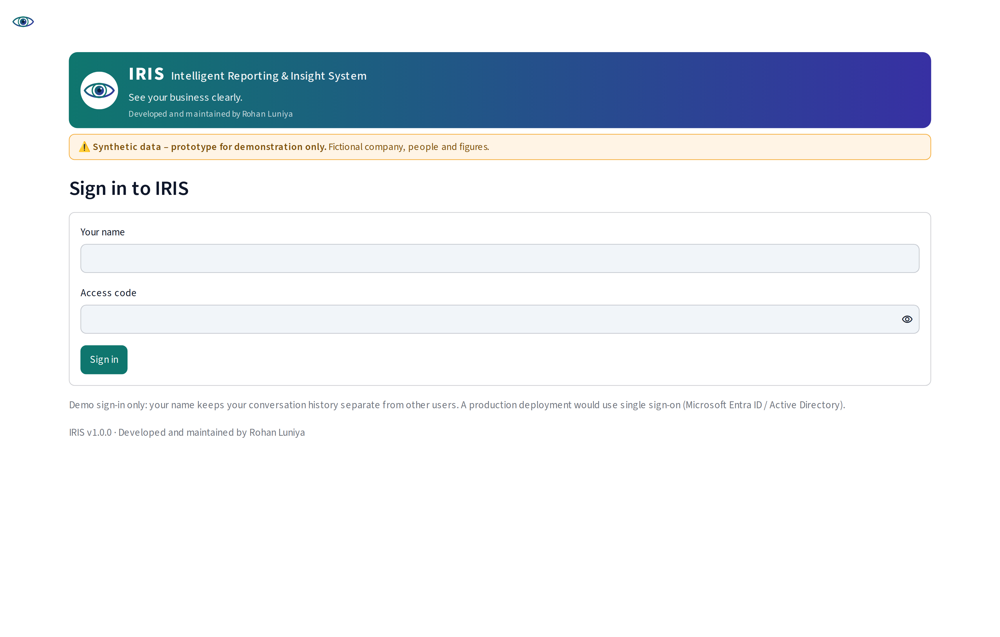
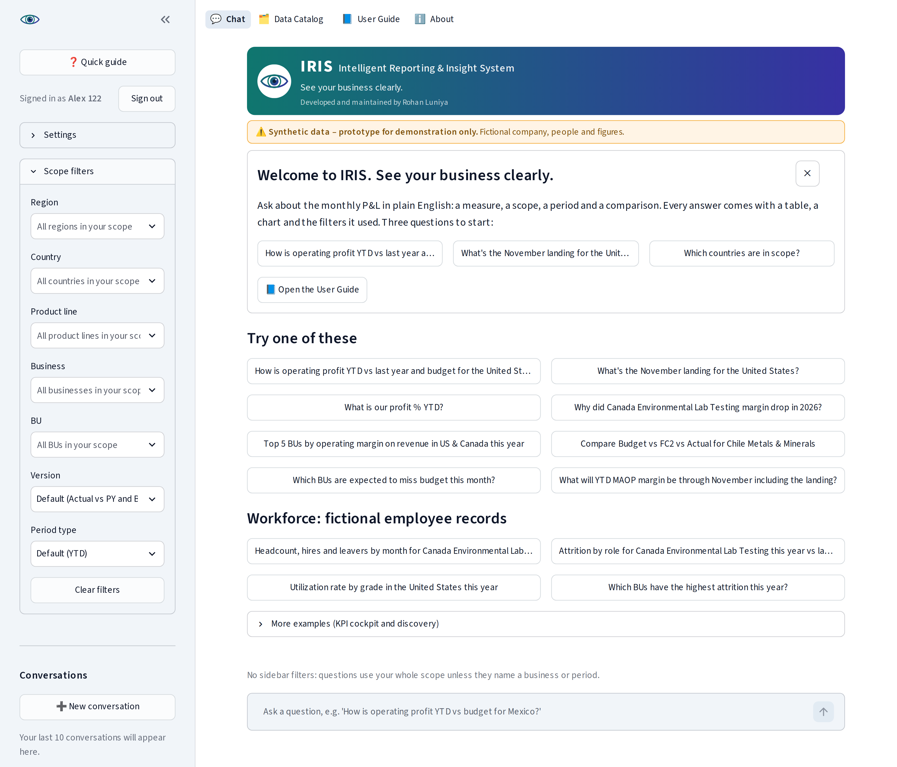
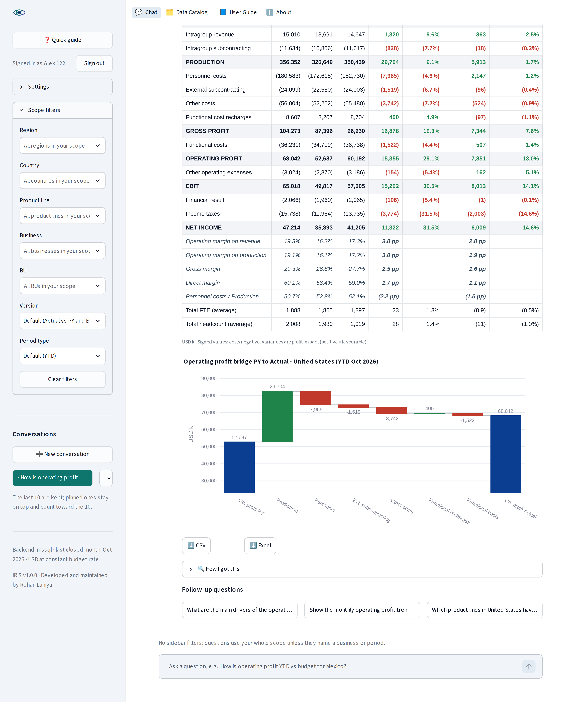
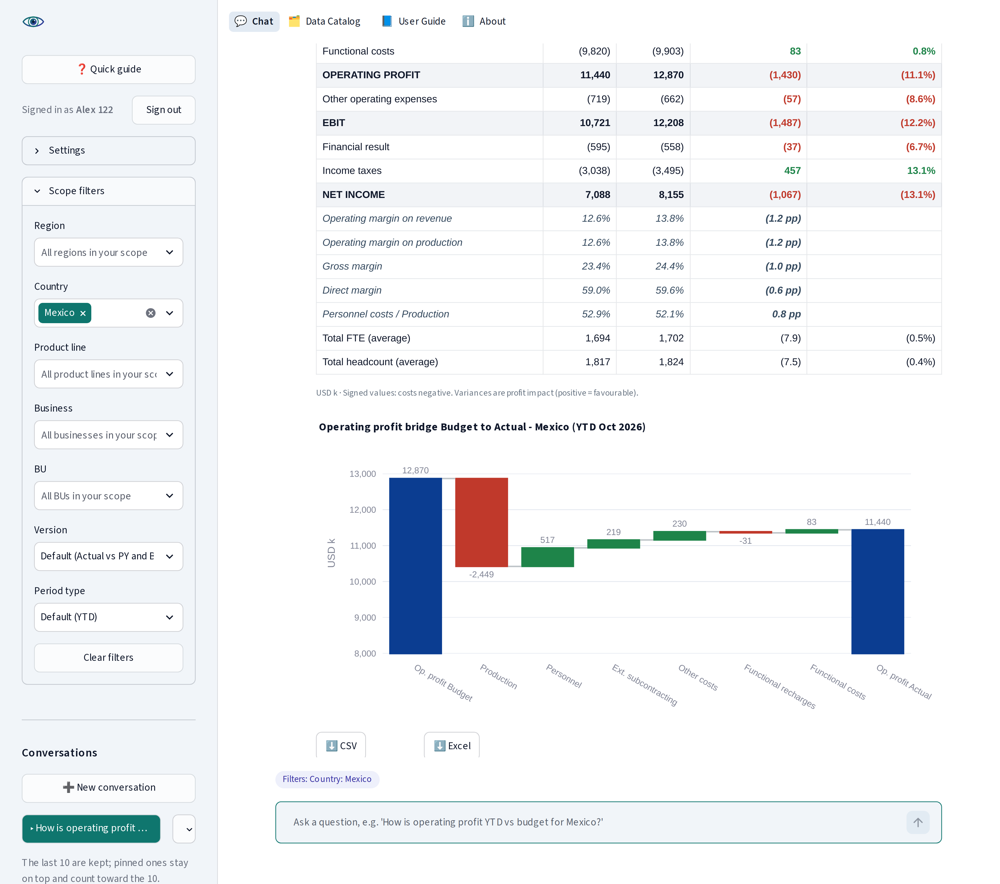
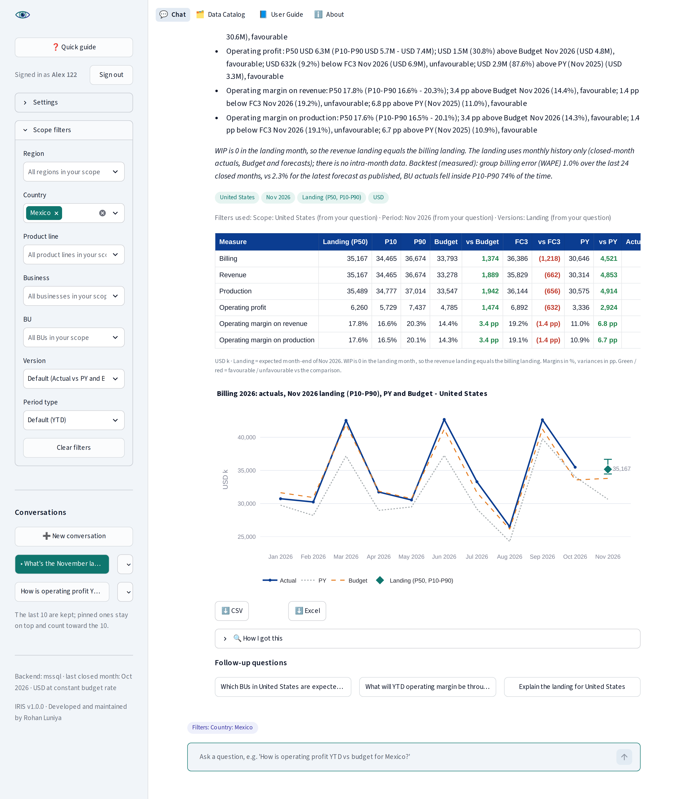
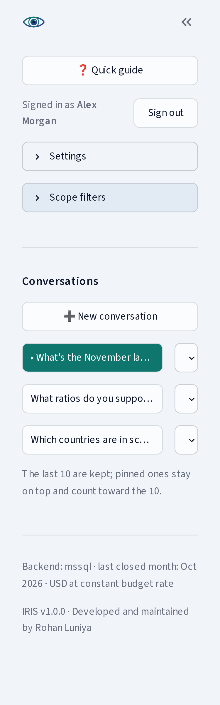

# IRIS user guide

IRIS (Intelligent Reporting & Insight System) answers questions about the monthly management P&L in plain
English. Each answer is a short insight, a finance-style table, a chart and the exact filters that were
used. All figures are synthetic: this is a prototype for demonstration only.

## 1. Getting started in 60 seconds

1. Open IRIS and sign in with your name and the access code you were given. Your name keeps your
   conversation history separate from other users.
2. Pick a question from the welcome card or type your own in the box at the bottom, for example
   *"How is operating profit YTD vs last year and budget for the United States?"*
3. Read the answer: the first line gives the headline, the table and chart show the detail, and
   *Filters used* lists the scope, period and versions.
4. Click a follow-up question, or keep typing: *"now for Canada"*, *"why?"*, *"show it by month"*.

## 2. Sidebar filters or typing?

Both work, and they combine:

- The **Scope filters** in the sidebar (Region, Country, Product line, Business, BU, then Version and
  Period) are the default context for every question. They cascade: choosing a country narrows the product
  lines, businesses and BUs to that country. You only ever see the parts of the organisation you have access
  to.
- Anything you **type wins** for that question. With the sidebar set to Mexico, *"How is Canada doing?"*
  answers for Canada; the answer says so under *Filters used* (for example "Scope: Canada (from your
  question)").
- The active filters are shown as chips just above the chat box. **Clear filters** in the sidebar removes
  them. Changing a filter in the middle of a conversation keeps the conversation; the next answer uses the
  new filters.
- **Settings** holds the persona (whose data access to use), the as-of date, the model and the units
  (USD k or USD M).

## 3. What makes a good question

A good question names four things:

| Part | Examples |
|---|---|
| Measure | operating profit, revenue, billing, production, personnel costs, operating margin on revenue, profit % |
| Scope | the group, US & Canada, the United States, Environmental Lab Testing, Canada Environmental Lab Testing, one BU |
| Period | this month, last month, YTD, Q3 2026, rolling 12 months, FY 2025, since 2024 |
| Comparison | vs last year, vs budget, vs FC2, vs the latest forecast |

If you leave something out, IRIS uses a sensible default (your whole scope, YTD, Actual vs last year and
Budget) and tells you what it assumed.

## 4. Example gallery

Click any question in the app to try it.

<!-- gallery:start -->
- **Performance:** How is operating profit YTD vs last year and budget for the United States?
- **Performance:** How is Canada doing this year?
- **Margins:** What is our profit % YTD?
- **Margins:** Operating margin on production for US & Canada vs budget
- **Trends:** Show revenue by month since 2024 for Mexico
- **Drivers:** Why did Canada Environmental Lab Testing operating profit drop vs last year?
- **Rankings:** Which 5 BUs have the lowest operating margin on revenue YTD?
- **Versions:** Compare budget, FC2 and FC3 for Mexico this year
- **Drill-down:** Break down personnel costs for US Elevators & Pressure Vessels
- **Landing:** What's the November landing for the United States?
- **Landing:** Which BUs are expected to miss budget this month?
- **Landing:** What will YTD MAOP margin be through November including the landing?
- **Discovery:** Which countries are in scope?
- **Discovery:** What ratios do you support?
- **Follow-ups:** now for Mexico
- **Follow-ups:** how does that compare with last year?
<!-- gallery:end -->

## 5. Reading an answer

- **Headline:** the first sentence answers the question with the main number and comparison.
- **Chips and *Filters used*:** scope, period, versions and currency, and where each came from (your
  question, the sidebar filters, the conversation, or a default). Follow-up answers also show a
  *Carried over* line, for example "Carried over: Mexico, YTD Oct 2026".
- **Table:** finance layout with variances; green is favourable and red unfavourable (for costs, lower is
  favourable). Margin variances are in percentage points (pp).
- **Chart:** chosen for the question (trend line, bar comparison, waterfall of drivers, ranking).
- **How I got this:** the filters, the tool the assistant called, the numeric guardrail result and the SQL.
- **Downloads:** CSV or Excel of the table.
- **Margins:** *profit %*, *margin* or *MAOP %* without a base shows both operating margins side by side:
  on revenue and on production. Name the base (*"margin on revenue"*) to get one.

## 6. Understanding the landing

The landing is the expected month-end result of the **open month**: the month after the last closed month
(months close on the 5th of the following month). It covers billing, revenue, production, the cost lines,
operating profit and both operating margins, for every BU and every level above.

- It is calculated by a separate, tested engine from **monthly history only**: closed-month actuals, the
  Budget and the forecasts. There is no intra-month data.
- **WIP is 0 in the landing month**, so the revenue landing equals the billing landing.
- Each landing shows **P50** (the central estimate) and a **P10-P90 range**: in the engine's own backtest,
  the actual result fell inside the range most of the time; the measured coverage and error are on the
  Data Catalog page (Landing tab) and in the backtest report.
- *"What will YTD margin be through November including the landing?"* adds the November landing to the
  closed months January-October and compares with last year, the Budget and the latest forecast.
- A closed month has no landing (you get the actuals); a future month has none either (you get the latest
  forecast).
- Old landing answers in a resumed conversation are labelled *Landing as of <date>* with a **Refresh with
  latest landing** button when a newer landing exists.

## 7. Conversations

- **New conversation** in the sidebar starts a fresh thread; the current one is saved automatically.
- Your **last 10 conversations** are listed with their title and when they were last used. Click one to
  reopen it: the answers come back exactly as they were (no recalculation), and the filters and context
  are restored, so follow-up questions keep working.
- The **⋯** menu next to a conversation lets you rename it, pin it to the top, or delete it (with a
  confirmation).
- When an 11th conversation starts, the oldest unpinned one is deleted. Pinned conversations count toward
  the 10; if all 10 are pinned, unpin one first.
- Conversations are private to your sign-in name.

## 8. Glossary

| Term | Meaning |
|---|---|
| Billing | Amounts invoiced to customers in the month |
| WIP & deferred income | Change in work in progress and deferred income; Revenue = Billing + WIP & deferred income |
| Production | Revenue plus intragroup revenue and intragroup subcontracting |
| Operating profit (MAOP) | Gross profit minus functional costs; the headline profit line |
| Operating margin on revenue | Operating profit / Revenue |
| Operating margin on production | Operating profit / Production |
| Profit % | Both operating margins side by side |
| Budget | The annual plan set before the year starts |
| FC1, FC2, FC3 | Reforecasts with 4, 8 and 9 months of actuals |
| Latest forecast | The newest of FC3, FC2 and FC1 published for the year (else the Budget) |
| Landing | Expected month-end result of the open month (P50 with a P10-P90 range) |
| P10 / P50 / P90 | Low, central and high estimate of the landing |
| YTD, QTD, R12M, FY | Year to date, quarter to date, rolling 12 months, full year |
| PY | Prior year, same months |
| pp | Percentage points (the difference between two percentages) |
| BU | Business unit, the lowest level of the organisation |
| WAPE | Weighted absolute percentage error: sum of absolute errors / sum of actuals |
| Row-level security | Each persona only sees the businesses it has access to |

## 9. Limitations and FAQ

- **Is this real data?** No. The company, people and figures are synthetic; the structure mirrors the
  target model.
- **Which months are covered?** Monthly data from January 2022 to the last closed month, plus the landing
  for the open month. There is no daily or intra-month data.
- **Why is an answer slow?** The language model runs on CPU in this prototype. Choose *rules (no LLM)* in
  Settings for instant answers with templated text.
- **Can the assistant invent numbers?** Every number comes from the database or the landing engine. A
  numeric guardrail checks the numbers in the text against the data before you see it; *How I got this*
  shows the SQL.
- **Why can't I see a country?** Your persona's data access does not include it; the answer says so.
- **How accurate is the landing?** Only measured figures are shown: see the Data Catalog page (Landing tab)
  and the backtest report.
- **Sign-in:** the name and access code are a demo sign-in. A production deployment would use single
  sign-on (Microsoft Entra ID / Active Directory).
- **Contact:** Rohan Luniya, who develops and maintains IRIS.
